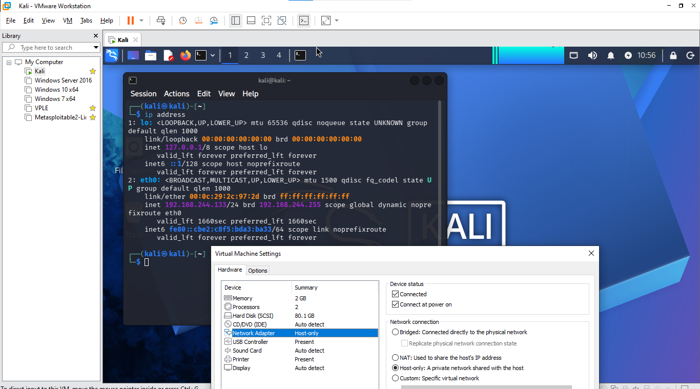
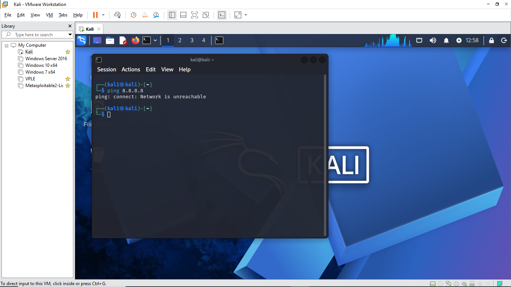

# Task B1
---
This confirms the network adapter is set to Host-only mode and displays the local IP address assigned to the eth0 interface (192.168.244.133), proving the VM is restricted to internal communication.
\

\
This displays the kernel routing table via ip route, showing only a direct local subnet route (192.168.244.0/24) without any default gateway (0.0.0.0/0), confirming there is no path to outside networks.
\

\
This demonstrates a failed ping to the public DNS server 8.8.8.8 with a "Network is unreachable" error, verifying that outbound internet access is successfully blocked.
\

# Task B2
---
## Create and List a File
I have created a text file with the following permissions:
* user can read and write
* group can also read and write
* others can only read \
\

## Changing Permissions with chmod
I removed the write permission from the user and added the execute permission
\

\
I have granted all the permissions to user, group, and others.
\

\
I allowed user to read, group to write, and others to execute.
\

\
I have removed all the permissions from user, group, and others.
\

