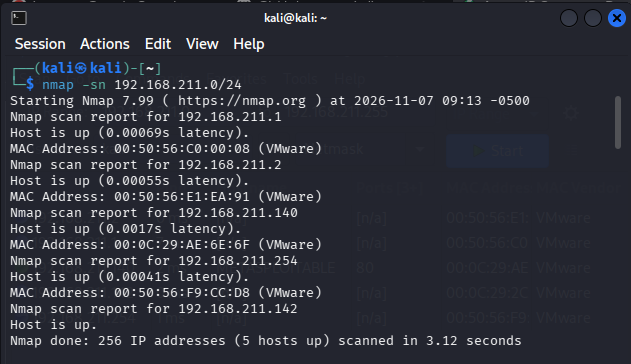
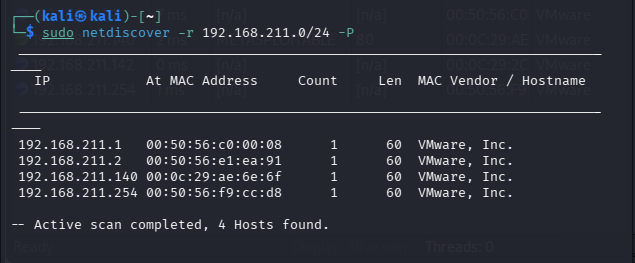
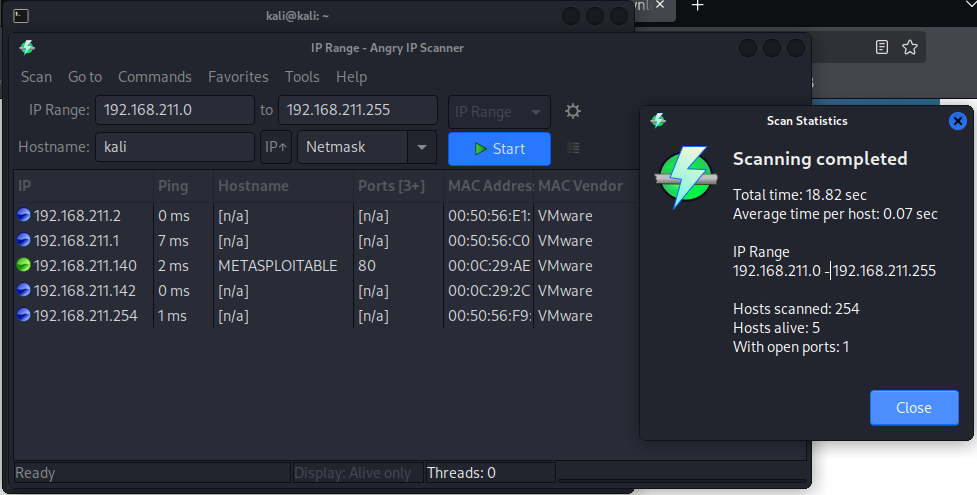

# Task B1 - Host Discovery
## Host Discovery with Nmap

## Host Discovery with Netdiscover

## Host Discovery with Angry Ip Scanner (ipscan)

### Explanation:
Nmap scans all the hosts including the machine on which it is run. Netdiscover does not perform scanning against the system(kali) on which it is run. ipscan runs on every hosts including the system on which it is run. It is a GUI based system, so it is more readable. It also provided the hostname, while the other two did not. It also showed the open port (80) on Metasploitable. The host with open ports is shown with green colour and the other hosts with blue port.192.168.211.1, 192.168.211.2, and 192.168.211.254 are the default gateways of vnet. All tools shows the total live hosts.

# Task B3 - Decoding CVE-2011-2523
#### CVSS Vector : CVSS:3.1/AV:N/AC:L/PR:N/UI:N/S:U/C:H/I:H/A:H
| CVSS Metric | Value | Human-Friendly Explanation |
|---|---|---|
| AV – Attack Vector | N | An attacker can target the server remotely through a network without needing physical access to it. |
| AC – Attack Complexity | L | The attack is relatively easy to carry out and does not require any complicated steps or special conditions. |
| PR – Privileges Required | N | The attacker does not need a username, password, or an existing account on the server. |
| UI – User Interaction | N | No action is required from the victim. The attacker can carry out the attack without asking anyone to click or approve anything. |
| S – Scope | U | The attack affects the same system where the vulnerability exists, rather than spreading its impact to a separate security environment. |
| C – Confidentiality | H | Once access is gained, the attacker may be able to view sensitive information, such as files, passwords, and system configurations. |
| I – Integrity | H | The attacker may be able to change, delete, or modify important files and system settings without permission. |
| A – Availability | H | The attacker may disrupt the server, stop important services, or make the system unavailable to legitimate users. |